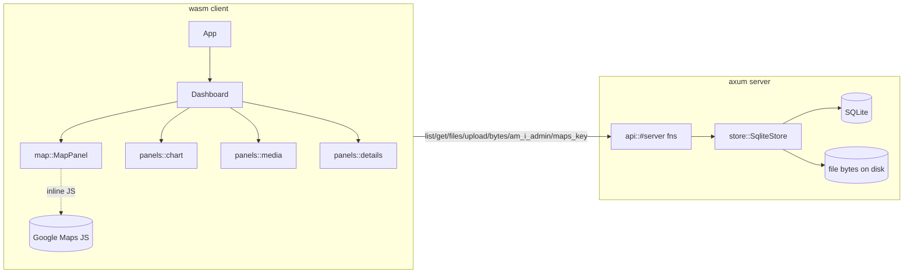

# Architecture

A **page microfrontend** visualising the firm's property allocation: a docked
dashboard (portfolio map, price-series chart, media/documents, deal details) for a
selected property. A Dioxus 0.7 client (`<mfe-real-estate-data>`, CSR — no SSR, no
hydration) plus an axum server with the `#[server]` functions, on top of `ev`
(`architecture` + `uikit`) and `v_utils`.

It mounts inside a host page that hands it an OAuth token + admin list, so there is
**no login** — admin actions are gated on a token the host puts on
`window.__reaAdminToken`, re-checked server-side.



## Modules (`src/`)
- `domain` — `Property`, `PropertyState`, value objects (`Money`, `ResearchUrl`,
  …), `Id` tags, `Entity`/`AggregateRoot`, and the `InState` `Specification`.
- `error` — `DomainError` (thiserror).
- `store` *(server-only)* — `SqliteStore` + the leaf `PropertyRepository` port,
  schema, `Row` `TryFrom`s, and `seed`. Specs filter **in memory** (`spec.holds`);
  SQL pushdown is descoped. File bytes live on disk; only metadata is in SQLite.
- `api` — the **only** client↔server seam. `#[server]` fns pull the store/config
  out of the fullstack context via `consume_context`.
- `config` *(server-only)* — `AppConfig` (`maps_api_key`, `db_path`, `data_dir`,
  `admin_token`, `admins`) over `v_utils` `LiveSettings`.
- `app` / `dashboard` / `panels` — UI. `app::App` is the root (no router: the host
  owns the URL; deep links are read off its query, see **Embedding**). Selection is
  a root `Signal<Option<BuildingId>>` shared via context; each panel `use_resource`s
  keyed on it.
- `map` — **isolated** Google-Maps module; the only file touching the JS API. The
  inline-JS `extern` is fully `cfg(wasm32)`-gated, so the server build never links it.

## Property Info Standard
What we provide about a property (`domain::Property`). Required fields carry a
validating value object so a bad one can't enter the domain; optional fields are
`Option` and rendered only when present.

| Field | Type | Req. | Invariant / notes |
| --- | --- | --- | --- |
| `id` | `PropertyId` (`Id<PropertyTag>`, Uuid) | yes | minted on insert |
| `coords` | `Coords { lat, lng }` | yes | Google-Maps marker position |
| `price` | `Money` | yes | non-negative, finite |
| `state` | `PropertyState` | yes | `Purchased(Timestamp)` (carries the purchase instant) \| `Interesting` \| `Purchasing` |
| `research_url` | `ResearchUrl` | yes | non-empty http(s) — the reasoning post |
| `terms` | `Option<String>` | no | deal terms, free text |
| `deal` | `Option<DealStructure { equity_pct, debt_pct, notes }>` | no | deal structure |
| `loan` | `Option<LoanRates { rate_pct, term_years, lender }>` | no | rates if not bought outright |
| `additional_reasoning` | `Option<String>` | no | miscellaneous notes worth surfacing |
| `price_series` | `Vec<(Timestamp, f64)>` | — | dated weekly value estimates; **mock**, filled on read, never persisted |

Associated media (pics / pitch-deck / documents) are separate `PropertyFile`
records (`{ id, property_id, kind: Pic|PitchDeck|Document, filename, content_type }`),
not fields on `Property`.

## Embedding
Two microfrontends, both `ev_lib::mfe!` custom elements mounted in the host's light
DOM (never an iframe), both reading the locale off the host's `<html lang>`:

| element | crate | kind | served by | mounted at |
|---|---|---|---|---|
| `<mfe-real-estate-data>` | `real_estate_allocation_data` (this dashboard) | page | REA itself, `/mfe/data/` | estate host `/data` |
| `<mfe-real-estate-overview>` | `real_estate_allocation_embeds` (marketing tile) | component | baked into the host's `public/mfe/` (`nix build .#embeds`) | landing / estate pages |

The page bundle lives same-origin with its host: the edge routes `/mfe/data/*` and
`/api/embed/*` on `https://estate.evinvest.ltd` to this server (`rea.evinvest.ltd`
is gone). What the server answers (`main.rs`):

| path | what | cache |
|---|---|---|
| `/mfe/data/mfe-real-estate-data.js` | the stable entry the host registry points at | `no-cache` + content `ETag` |
| `/mfe/data/data.css` | the stylesheet `mfe!` injects (`input.css`, utilities in `reamfe`) | `no-cache` + content `ETag` |
| `/mfe/data/<rev>/*` | wasm-bindgen glue, wasm, snippets (`<rev>` = content hash at boot) | `immutable` |
| `/mfe/data/api/*` | the `#[server]` fns (root set by the bundle from its own origin) | — |
| `/api/embed/building/{id}` | the overview tile's plain JSON | — |
| `/health` | probe | — |

Invariants:
- **No `dioxus/fullstack` in the wasm graph.** It forces `dioxus-web/hydrate`, and a
  host page carries no hydration data; server-fn stubs come from `dioxus-fullstack`
  directly. Nothing in the client may use `asset!` (manganis URLs are `dx`'s).
- **The host owns the document**: fonts, tokens and preflight cascade in; our CSS is
  utilities-only in the host's lowest layer.
- **Deep links are the host URL's query** (`?building=`, `?appt=`, `?selection=`),
  read at mount and kept current with `replaceState` that preserves the host's state.
- **Shell-free tile.** The overview renders only its section; its deep links point at
  `<rea-url>/data?building=…`.

## Persistence
- SQLite via `sqlx` (`runtime-tokio`, `sqlite`). One pool, schema run on startup.
- File bytes: `./data/properties/<property_id>/<file_id>__<filename>`.
- `price_series` is a **mock** (`v_utils::laplace_random_walk`, seeded per id),
  filled by `api::get_property` and never persisted. Points carry real dates anchored
  to the purchase instant, so a long-held property's series runs out before today and
  the chart projects a dotted tail to now.

## Build / run
Requires `nix develop` (the `wasm32` target, `wasm-bindgen-cli` pinned to the crate,
Tailwind v4).

```sh
nix run .#dev            # debug page bundle → target/debug/public, then the server
                         # on :59079 (bare harness at /; estate's /data is the real host)
nix build .#mfe-data     # the release page bundle; `.#default` = server + it in public/
nix run .#dev-embeds     # the overview tile, standalone
```

Seeding runs on first launch when the DB is empty (~6 properties across all three
states, plus a sample pic). Config (incl. `maps_api_key`, `admin_token`) is read
through `LiveSettings`; without a Maps key the map shows a placeholder. The Maps key
is referrer-restricted: the host origin must be on its allowlist.
